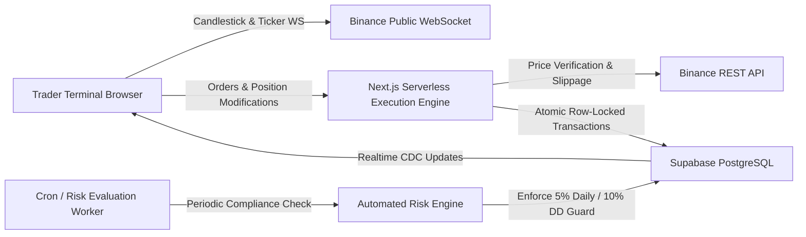

# PropEdge — Proprietary Trading Evaluation & Funded Accounts Platform

PropEdge is a high-performance proprietary trading firm platform built for worldwide strategy evaluation and funded account management. Prospective traders evaluate their risk disciplines across two structured phases with real-time public cryptocurrency liquidity feeds and earn an **80% performance profit split** upon funding.

---

## 1. System Architecture & Core Mechanics

PropEdge provides institutional-grade evaluation rules matching leading proprietary firms (FTMO, FundedNext):
1. **Challenge Tiers**: Traders select evaluation accounts ($10,000, $25,000, $50,000, or $100,000 starting balances).
2. **Two-Phase Evaluation**:
   - **Phase 1 (Evaluation)**: Reach an 8.0% profit target with a minimum of 5 active trading days.
   - **Phase 2 (Verification)**: Confirm performance consistency with a 5.0% profit target across 5 active trading days.
3. **Institutional Risk Limits**:
   - **Daily Loss Limit**: 5.0% (dynamically measured from equity at 00:00:00 UTC each day).
   - **Maximum Overall Drawdown**: 10.0% (static boundary against initial challenge balance).
   - **Maximum Leverage**: 1:20 notional leverage.
4. **Funded Accounts & Profit Splits**: Traders passing both phases advance to `funded` status and can submit withdrawal requests for an **80% profit split**.
5. **Firm Administration**: Administrative control center to monitor accounts, inspect compliance logs, manage payouts, and oversee firm-wide exposure.



---

## 2. Tech Stack

- **Framework**: Next.js 14 (App Router, Server Actions, Route Handlers, TypeScript)
- **Styling & UI**: Tailwind CSS, shadcn/ui component primitives, Lucide React
- **Terminal Charting**: TradingView Lightweight Charts (`lightweight-charts`)
- **Market Price Feeds**:
  - *Browser*: Binance public WebSocket (`wss://stream.binance.com:9443`) for real-time tickers and depth
  - *Server*: Binance public REST (`https://api.binance.com/api/v3/ticker/bookTicker`) for zero-trust order execution validation
- **Database & Auth**: Supabase (PostgreSQL, Row Level Security, GoTrue Auth, Realtime publications)
- **Payments**: Stripe Checkout Sessions & Webhooks (or direct beta test instant provisioning)
- **Email Service**: Resend API & Supabase custom SMTP integration (100% free tier available)

---

## 3. Environment Variables Configuration

Create a `.env.local` file with the following variables:

```bash
# App URL (Use your Vercel deployment URL in production)
NEXT_PUBLIC_APP_URL=https://your-propfirm.vercel.app

# Supabase Credentials (from Supabase Project Settings -> API)
NEXT_PUBLIC_SUPABASE_URL=https://your-project.supabase.co
NEXT_PUBLIC_SUPABASE_ANON_KEY=eyJhbGciOi...
SUPABASE_SERVICE_ROLE_KEY=eyJhbGciOi...

# Stripe (Optional for Paid Challenges; If omitted, instant beta demo provisioning activates)
STRIPE_SECRET_KEY=sk_test_...
NEXT_PUBLIC_STRIPE_PUBLISHABLE_KEY=pk_test_...
STRIPE_WEBHOOK_SECRET=whsec_...

# Email Notifications (Resend free tier at resend.com - 3,000 emails/month free)
RESEND_API_KEY=re_...
```

---

## 4. Supabase Setup (0-Cost Free Tier)

1. Create a free project at [supabase.com](https://supabase.com).
2. Go to **SQL Editor** in your Supabase dashboard.
3. Open `supabase/full_schema.sql` from this repository, copy all contents, paste into the SQL Editor, and click **Run**.
4. In **Project Settings -> API**, copy:
   - Project URL -> `NEXT_PUBLIC_SUPABASE_URL`
   - `anon` `public` key -> `NEXT_PUBLIC_SUPABASE_ANON_KEY`
   - `service_role` `secret` key -> `SUPABASE_SERVICE_ROLE_KEY`
5. In **Authentication -> URL Configuration**:
   - Set **Site URL** to `https://your-propfirm.vercel.app`
   - Add Redirect URLs: `https://your-propfirm.vercel.app/**`

---

## 5. Vercel Deployment (0-Cost Free Hosting & Domain)

1. Push your repository to GitHub.
2. Sign in to [vercel.com](https://vercel.com) using your GitHub account.
3. Click **Add New... -> Project** and import your repository.
4. Framework Preset: **Next.js**.
5. Under **Environment Variables**, paste the keys from Section 3.
6. Click **Deploy**.
7. Vercel automatically generates your worldwide live production URL (e.g., `https://propedge.vercel.app`).
