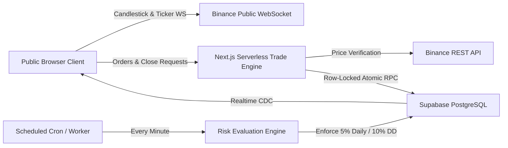

# PropEdge — Simulated Proprietary Trading Firm Platform

> **DISCLAIMER: SIMULATION & EDUCATIONAL DEMONSTRATION ONLY**  
> PropEdge is an educational proprietary trading firm simulator built as a college capstone project. All market executions utilize paper trading powered by real-time public cryptocurrency feeds from Binance. No real fiat or cryptocurrency funds are ever deposited, traded, or placed at risk. No real financial services or brokerage services are provided.

---

## 1. Project Overview & Architecture

PropEdge simulates the operational lifecycle of a modern proprietary trading firm (such as FTMO or FundedNext):
1. **Challenge Purchases**: Prospective traders choose evaluation accounts ($10k, $25k, $50k, $100k) and checkout using Stripe Test Mode.
2. **Two-Phase Evaluation**:
   - **Phase 1**: Reach an 8.0% profit target with a minimum of 5 active trading days.
   - **Phase 2**: Reach a 5.0% profit target with a minimum of 5 active trading days.
3. **Risk Boundaries**:
   - **Max Daily Loss**: 5.0% (calculated from account equity at 00:00:00 UTC).
   - **Max Total Drawdown**: 10.0% (calculated from initial challenge balance).
   - **Max Leverage**: 1:20 notional.
4. **Funded Accounts**: Once both phases are passed, accounts transition to `funded`, granting simulated profit payouts with an **80% virtual profit split**.
5. **Admin Control Center**: Firm administration can monitor all accounts, inspect audit logs, approve simulated payouts, and trigger manual evaluation overrides.



---

## 2. Tech Stack

- **Frontend & Full-Stack**: Next.js 14 (App Router, Server Actions, Route Handlers, TypeScript)
- **Styling & UI**: Tailwind CSS, shadcn/ui component primitives, Lucide React
- **Charting**: TradingView Lightweight Charts (`lightweight-charts`)
- **Market Price Feeds**:
  - *Browser-Side*: Binance public WebSocket (`wss://stream.binance.com:9443`) for tick-by-tick order book depth and candlestick streams
  - *Server-Side*: Binance public REST (`https://api.binance.com/api/v3/ticker/bookTicker`) for zero-trust order verification
- **Database & Auth**: Supabase (PostgreSQL, Row Level Security, GoTrue Auth, Realtime publications)
- **Payments**: Stripe (Test Mode Checkout Sessions + Webhook handler)
- **Validation**: Zod
- **Unit Testing**: Vitest

---

## 3. Directory Layout

```
Propfirm/
├── app/
│   ├── (auth)/
│   │   ├── login/page.tsx
│   │   ├── signup/page.tsx
│   │   └── reset-password/page.tsx
│   ├── (dashboard)/
│   │   ├── dashboard/page.tsx
│   │   ├── terminal/page.tsx
│   │   ├── leaderboard/page.tsx
│   │   └── payouts/page.tsx
│   ├── (admin)/
│   │   └── admin/page.tsx
│   ├── api/
│   │   ├── trades/execute/route.ts
│   │   ├── trades/close/route.ts
│   │   ├── trades/modify/route.ts
│   │   ├── trades/tick-eval/route.ts
│   │   ├── trades/journal/route.ts
│   │   ├── risk/evaluate/route.ts
│   │   ├── checkout/route.ts
│   │   ├── webhooks/stripe/route.ts
│   │   └── admin/route.ts
│   ├── pricing/page.tsx
│   ├── checkout/success/page.tsx
│   ├── checkout/cancel/page.tsx
│   ├── globals.css
│   ├── layout.tsx
│   └── page.tsx
├── components/
│   ├── terminal/
│   │   ├── chart.tsx
│   │   ├── watchlist.tsx
│   │   ├── order-panel.tsx
│   │   ├── positions-table.tsx
│   │   └── account-summary-bar.tsx
│   ├── dashboard/
│   │   ├── metrics-grid.tsx
│   │   ├── rules-progress.tsx
│   │   ├── equity-curve.tsx
│   │   └── trading-journal.tsx
│   ├── layout/
│   │   ├── navbar.tsx
│   │   └── simulation-banner.tsx
│   └── ui/ (button, card, dialog, input, progress, slider, tabs, badge)
├── lib/
│   ├── binance/ (rest.ts, websocket.ts)
│   ├── engine/ (margin.ts, pnl.ts, slippage.ts, risk.ts)
│   ├── supabase/ (client.ts, server.ts, admin.ts, middleware.ts)
│   ├── stripe/ (stripe.ts)
│   ├── email/ (notifications.ts)
│   └── utils.ts
├── supabase/
│   └── migrations/
│       ├── 20260101000000_init_schema.sql
│       ├── 20260101000001_rls_policies.sql
│       ├── 20260101000002_seed_plans.sql
│       └── 20260101000003_functions_triggers.sql
├── tests/
│   ├── engine.test.ts
│   └── risk.test.ts
├── .env.example
├── vitest.config.ts
└── README.md
```

---

## 4. Quick Start & Setup Guide

### Step 1: Install Dependencies
```bash
# In C:\Users\Acer\Desktop\Propfirm
pnpm install
# Or: npm install
```

### Step 2: Configure Environment Variables
Copy `.env.example` to `.env.local`:
```bash
cp .env.example .env.local
```
Provide your test keys:
- `NEXT_PUBLIC_SUPABASE_URL`: Your Supabase Project URL (`https://xyz.supabase.co`)
- `NEXT_PUBLIC_SUPABASE_ANON_KEY`: Supabase anon public key
- `SUPABASE_SERVICE_ROLE_KEY`: Supabase service_role secret key
- `NEXT_PUBLIC_STRIPE_PUBLISHABLE_KEY`: `pk_test_...`
- `STRIPE_SECRET_KEY`: `sk_test_...`
- `STRIPE_WEBHOOK_SECRET`: `whsec_...`
- `CRON_SECRET`: Random string for protecting risk evaluation endpoint

*(Note: If you run locally without Supabase/Stripe credentials, PropEdge automatically includes an offline demo fallback that provisions demo accounts and simulation state so you can test all features immediately!)*

### Step 3: Apply Supabase Migrations
1. Open your Supabase project SQL Editor.
2. Execute the migrations in order:
   - `supabase/migrations/20260101000000_init_schema.sql`
   - `supabase/migrations/20260101000001_rls_policies.sql`
   - `supabase/migrations/20260101000002_seed_plans.sql`
   - `supabase/migrations/20260101000003_functions_triggers.sql`

### Step 4: Run the Development Server
```bash
pnpm dev
# Or: npm run dev
```
Open [http://localhost:3000](http://localhost:3000) in your browser.

### Step 5: Run Automated Unit Tests
```bash
pnpm test
```
Runs the 15 unit tests covering margin requirements, long/short P&L calculations, slippage models, and drawdown compliance.

---

## 5. Deployment Guide (Vercel Free Tier)

1. Push your repository to GitHub.
2. In Vercel, click **Add New Project** and select your repository.
3. In **Environment Variables**, paste the keys from `.env.local`.
4. Click **Deploy**.
5. Set up Vercel Cron for automated minute risk evaluation:
   Create `vercel.json` in root:
   ```json
   {
     "crons": [
       {
         "path": "/api/risk/evaluate",
         "schedule": "* * * * *"
       }
     ]
   }
   ```
6. Stripe Webhook configuration:
   - In Stripe Dashboard (Developers -> Webhooks), add an endpoint pointing to `https://your-domain.vercel.app/api/webhooks/stripe`.
   - Listen for `checkout.session.completed`.

---

## 6. End-to-End Demo Script for Reviewers

Follow this walkthrough to demonstrate the complete workflow:

1. **Authentication**:
   - Navigate to `/login`.
   - Click **Trader Demo** to prefill credentials, then sign in. (Or click **Create Account** at `/signup` to register).
2. **Pricing & Challenge Purchase**:
   - Navigate to `/pricing`.
   - Select the **Pro $25K Challenge**.
   - Click **Instant Demo Provision** (or **Stripe Test Checkout**).
   - Upon completion, you will be redirected to the Success page confirming your new account number (e.g. `PE-482019`) in **Phase 1**.
3. **MT5-Style Trading Terminal**:
   - Click **Launch Terminal** (`/terminal`).
   - Observe the live candlestick chart streaming directly from Binance for `BTCUSDT`. Switch timeframes (`1m`, `5m`, `15m`, `1h`, `4h`, `1d`).
   - Select another pair from the Watchlist (e.g., `ETHUSDT` or `SOLUSDT`).
   - Set Size to `0.5`, Leverage to `1:10`, enter a Stop Loss and Take Profit.
   - Click **BUY / LONG**.
   - Notice the order is immediately verified server-side, row-locked, and inserted into the **Open Positions** table.
   - Watch the floating unrealized P&L update tick-by-tick.
   - Click **Modify** to change SL/TP, or click **Close** to realize P&L.
4. **Trading Journal**:
   - In the **Trade History** tab, click the Journal icon next to your closed trade.
   - Write an analytical reflection note (e.g. *"Clean trend pullback entry; discipline preserved"*). Save and view the saved note.
5. **Trader Dashboard**:
   - Navigate to `/dashboard`.
   - Observe the updated **Win Rate**, **Profit Factor**, and **Average R:R** metrics.
   - Inspect the **Rules Progress** gauges (Daily Loss vs 5%, Total Drawdown vs 10%, Profit Target progress).
   - View the generated **Simulated Equity Curve**.
6. **Risk Evaluation & State Transitions**:
   - Click **Evaluate Risk** in the dashboard.
   - The engine validates all constraints, auto-closes positions on breach, and promotes accounts meeting the 8% target and 5 trading days to **Phase 2**, and subsequently to **Funded**.
7. **Simulated Payout Request**:
   - Once in **Funded** status, navigate to `/payouts`.
   - View your withdrawable profit and the auto-calculated **80% virtual profit split**.
   - Click **Request Payout**, enter an amount and simulated destination address, and submit.
8. **Admin Command Center**:
   - Navigate to `/admin`.
   - Inspect the full list of accounts, filter by status, and test manual override actions:
     - **Pass**: Force pass an account to Phase 2 or Funded.
     - **Fail**: Force breach an account (locks account and auto-closes open positions).
     - **Reset**: Reset account balance to starting allocation.
   - Under the **Payout Queue** tab, click **Approve** on the pending payout request.
   - Inspect the immutable compliance trail under the **Audit Log** tab.
9. **Leaderboard**:
   - Navigate to `/leaderboard` to view the competitive trader standings.

---

## 7. System Limitations & Architecture Analysis

### Why MT5 Desktop Is Not Directly Integrated

While PropEdge provides an MT5-style web trading experience, native direct integration with the MetaTrader 5 desktop client / server was deliberately avoided for the following architectural, legal, and operational reasons:

1. **Proprietary Binary Wire Protocol**:
   MetaQuotes MT5 uses a proprietary closed-source C++ binary communication protocol rather than standard REST, WebSocket, or JSON RPC protocols. Web browsers cannot natively establish raw TCP/binary socket connections to MetaTrader servers without non-standard native intermediate proxies.
2. **Prohibitive Licensing & Infrastructure Costs**:
   Integrating with authentic MT5 requires an institutional MetaQuotes Server Broker License, which typically starts at **$50,000 to $100,000+** in upfront costs plus thousands of dollars per month in server maintenance. This directly contradicts the requirement for a free-tier deployable educational project.
3. **Serverless Platform Incompatibility**:
   Platforms such as Vercel, AWS Lambda, and Cloudflare Workers operate on transient, stateless request-response lifecycles. MT5 manager bridges (such as MT5 Manager API or MT5 Gateway) require persistent stateful Windows server daemons running 24/7 in C++ or .NET environments.
4. **Desktop Client Installation Barrier**:
   Requiring users to download, install, and configure a desktop `.exe` program with custom broker server IPs creates significant friction. A modern, responsive web application (like modern web prop firms) ensures instant accessibility on desktop, tablet, and mobile.

### How the Simulated Engine Operates

PropEdge achieves an authentic proprietary firm simulation through the following architectural design:
- **Zero-Trust Order Execution**: The client browser never specifies the execution price, balance, or margin. When an order is placed, the server fetches the real-time order book ticker directly from Binance REST (`api.binance.com/api/v3/ticker/bookTicker`), applies a synthetic broker spread (0.02%), and simulates market slippage (0.01% - 0.03%).
- **Atomic Concurrency Protection**: High-frequency order submissions and position closures utilize PostgreSQL row-level locks (`SELECT ... FOR UPDATE` via `execute_trade_atomic`) to prevent double-spending of free margin and balance race conditions.
- **Client-Side High-Frequency Feeds**: Candlestick charts and watchlist quotes stream directly from public Binance WebSockets into the user's browser, eliminating server bandwidth and persistent socket overhead on Vercel while delivering sub-second price updates.
- **Automated Rule Surveillance**: The risk engine monitors accounts at regular intervals, computing daily loss relative to UTC day-start equity and maximum drawdown relative to starting challenge balance, enforcing strict compliance identical to tier-1 prop firms.

